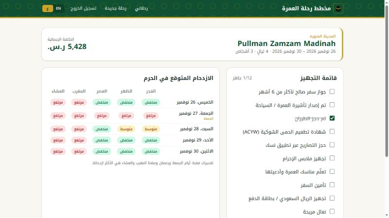

# 🕋 Umrah Trip Planner

A full-stack MERN app for planning an Umrah trip: pick a city and dates, choose a hotel near the Haram, see the full cost with VAT, track a preparation checklist and check expected crowd levels for each prayer. Available in **English and Arabic** with a fully mirrored right-to-left layout.

<!-- Live demo: add your Vercel URL here once deployed -->

## Screenshots

| Trip page (English) | Trip page (Arabic, RTL) |
| --- | --- |
|  |  |

| Dashboard | New trip wizard | Login |
| --- | --- | --- |
| _Add `docs/screenshots/dashboard.png`_ | _Add `docs/screenshots/wizard.png`_ | _Add `docs/screenshots/login.png`_ |

## Features

- **Accounts**: register and log in with email and password (bcrypt hashing, JWT auth). The token is stored in `localStorage` and attached by an Axios interceptor.
- **Hotels**: 8 seeded hotels in Makkah and Madinah with distance to the Haram, rating and nightly price in SAR.
- **3-step trip wizard**: city and dates → pick a hotel → review the cost breakdown.
- **Cost calculation** (server-side, unit tested):
  `total = nights × price per night × ceil(people / 2) rooms + 15% VAT`
- **Preparation checklist**: every new trip gets a default Umrah checklist (passport, visa, Nusuk permits, ihram, vaccinations…) that you can tick off.
- **Crowd levels** for every day of the trip and each of the five prayers:
  - **High**: Fridays, all of Ramadan (including the last 10 nights), and Maghrib/Isha
  - **Medium**: Fajr/Dhuhr on the weekend
  - **Low**: otherwise
  Ramadan is detected using the Umm al-Qura (Saudi) Hijri calendar built into Node's `Intl`.
- **Arabic and English** via react-i18next. Choosing Arabic sets `<html dir="rtl" lang="ar">`; the layout uses Tailwind logical properties (`ms-*`, `pe-*`, `text-start`, `border-s`) so it mirrors without duplicate styles. The language choice is saved in the browser and on the user's account.
- **Green and gold theme** with Inter and Noto Kufi Arabic fonts.

## Tech stack

| Layer | Tools |
| --- | --- |
| Frontend | React 19, Vite, Tailwind CSS v4, React Router, Axios, i18next / react-i18next |
| Backend | Node.js, Express 5, Mongoose, JSON Web Tokens, bcryptjs, dotenv, cors |
| Database | MongoDB Atlas |
| Testing | Jest, Supertest |
| Hosting | Vercel (client), Render (server) |

## Project structure

```
umrah-trip-planner/
├── client/                 React + Vite app
│   ├── src/api/            Axios instance and interceptors
│   ├── src/components/     Layout, CrowdBadge, LanguageSwitcher, ProtectedRoute
│   ├── src/context/        AuthContext
│   ├── src/i18n/           i18next setup and en/ar translations
│   ├── src/pages/          Login, Register, Dashboard, NewTrip, TripDetail
│   └── vercel.json
├── server/                 Express API
│   ├── src/controllers/
│   ├── src/middleware/     JWT auth
│   ├── src/models/         User, Hotel, Trip
│   ├── src/routes/
│   ├── src/services/       costService, crowdService, checklistService
│   ├── src/seed.js         Seeds 8 hotels
│   └── tests/              Jest tests
├── render.yaml             Render blueprint for the API
└── docs/screenshots/
```

## Getting started

### Prerequisites

- Node.js 18+ (22 recommended)
- A free [MongoDB Atlas](https://www.mongodb.com/atlas) cluster

### 1. Install

```bash
git clone https://github.com/abeelmazhar/Umrah-Trip-Planner.git
cd Umrah-Trip-Planner
npm run install:all
```

### 2. Configure the server

```bash
cp server/.env.example server/.env
```

| Variable | Description |
| --- | --- |
| `PORT` | API port (default `5000`) |
| `MONGO_URI` | MongoDB Atlas connection string |
| `JWT_SECRET` | Long random string used to sign tokens |
| `JWT_EXPIRES_IN` | Token lifetime, e.g. `7d` |
| `CLIENT_ORIGIN` | Allowed CORS origin(s), comma-separated, e.g. `http://localhost:5173` |

In Atlas, add your IP address under **Network Access**.

### 3. Seed the hotels

```bash
npm run seed
```

### 4. Run

In two terminals:

```bash
npm run dev:server   # http://localhost:5000
npm run dev:client   # http://localhost:5173
```

In development Vite proxies `/api` to the server, so the client needs no environment variables. In production set `VITE_API_URL` (see `client/.env.example`).

### 5. Test

```bash
npm test
```

## API

All responses are JSON. 🔒 = requires `Authorization: Bearer <token>`.

| Method | Endpoint | Auth | Description |
| --- | --- | --- | --- |
| GET | `/api/health` | | Health check |
| POST | `/api/auth/register` | | Body `{ name, email, password, preferredLanguage? }` → `{ token, user }` |
| POST | `/api/auth/login` | | Body `{ email, password }` → `{ token, user }` |
| GET | `/api/auth/me` | 🔒 | Current user |
| PATCH | `/api/auth/me` | 🔒 | Body `{ preferredLanguage: "en" \| "ar" }` |
| GET | `/api/hotels?city=Makkah` | | List hotels, optionally by city, nearest first |
| POST | `/api/trips/quote` | 🔒 | Price a trip without saving it → cost breakdown |
| POST | `/api/trips` | 🔒 | Body `{ city, startDate, endDate, people, hotelId }` → creates trip with cost and checklist |
| GET | `/api/trips` | 🔒 | List my trips |
| GET | `/api/trips/:id` | 🔒 | Get one of my trips |
| DELETE | `/api/trips/:id` | 🔒 | Delete one of my trips |
| PATCH | `/api/trips/:id/checklist/:itemId` | 🔒 | Body `{ done: true \| false }` |
| GET | `/api/crowd?date=YYYY-MM-DD&prayer=fajr` | | Crowd level. `prayer` is one of `fajr, dhuhr, asr, maghrib, isha`; omit it to get all five |

Example crowd response:

```json
{
  "date": "2026-11-28",
  "prayer": "fajr",
  "level": "Medium",
  "reasons": ["weekendPrayer"],
  "hijri": { "day": 18, "month": 6, "year": 1448 },
  "isRamadan": false,
  "isLastTenNights": false
}
```

## Deployment

### Server on Render

1. Push this repository to GitHub.
2. In [Render](https://dashboard.render.com): **New → Blueprint** and select the repository. Render reads `render.yaml` and creates the `umrah-trip-planner-api` web service from `server/`.
3. Fill in the environment variables it asks for:
   - `MONGO_URI`: your Atlas connection string
   - `CLIENT_ORIGIN`: your Vercel URL (you can update it after step 2 below)
   - `JWT_SECRET` is generated automatically.
4. In Atlas → **Network Access**, allow `0.0.0.0/0` (Render's free tier has no fixed outbound IPs).
5. Seed the database once from your machine (`npm run seed` with the same `MONGO_URI`) or from the Render shell.
6. Check `https://<your-service>.onrender.com/api/health` returns `{"status":"ok"}`.

> The free Render plan sleeps after inactivity, so the first request can take ~30 seconds.

### Client on Vercel

1. In [Vercel](https://vercel.com/new) import the repository.
2. Set **Root Directory** to `client`. The framework (Vite) and `vercel.json` are picked up automatically.
3. Add the environment variable `VITE_API_URL=https://<your-service>.onrender.com`.
4. Deploy, then put the Vercel URL into `CLIENT_ORIGIN` on Render.

`client/vercel.json` rewrites all paths to `index.html` so deep links like `/trips/123` work.

## Notes

- Hotel names and prices are sample data for demonstration only.
- Crowd levels are simple rule-based estimates, not live data.
- `bcryptjs` (a pure-JS bcrypt) is used instead of the native `bcrypt` package so installs work on any platform without build tools; hashes are compatible.

## License

MIT
