# 🕋 Umrah Trip Planner

A full-stack MERN app that helps pilgrims (zaireen) plan and perform Umrah: a **Makkah + Madinah itinerary** with hotels and intercity transport, **prayer times** with the **quietest time for Tawaf**, **miqat guidance**, a step-by-step **Umrah companion with Tawaf and Sa'i round counters**, **passport and vaccine checks** for every traveller, a **budget and expense tracker** in your home currency, a **read-only link to share the plan with family**, and **group mode** for families and Umrah groups: join by code or QR, a **bilingual lost-pilgrim card**, **meeting points** and opt-in **live location**. Fully bilingual (**English / Arabic**) with a mirrored right-to-left layout.

**Live demo:** https://umrah-trip-planner.vercel.app · **API:** https://umrah-trip-planner-api.vercel.app/api/health

## Screenshots

| Group mode: members & live location | Lost-pilgrim card (Arabic + English, QR) |
| --- | --- |
| 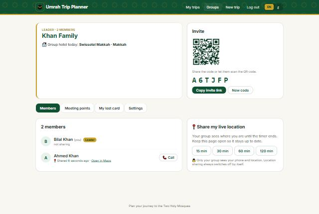 | 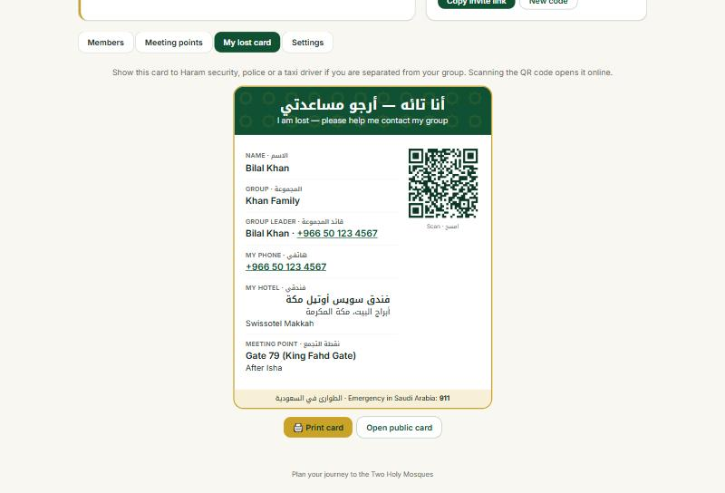 |

| Meeting points | Group page (Arabic, RTL) | Public card behind the QR code |
| --- | --- | --- |
| 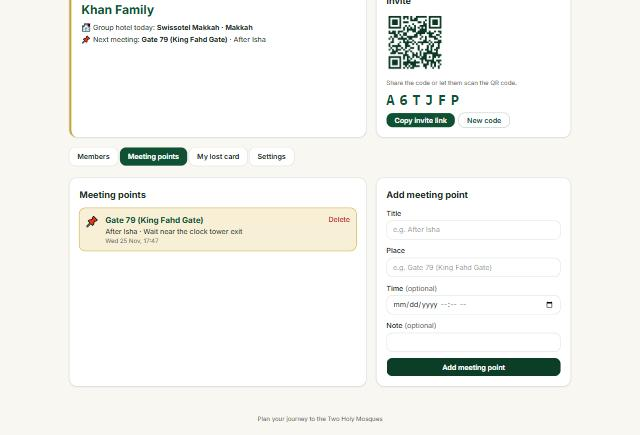 | 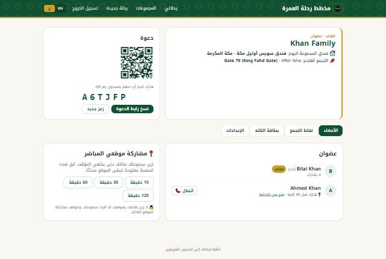 | 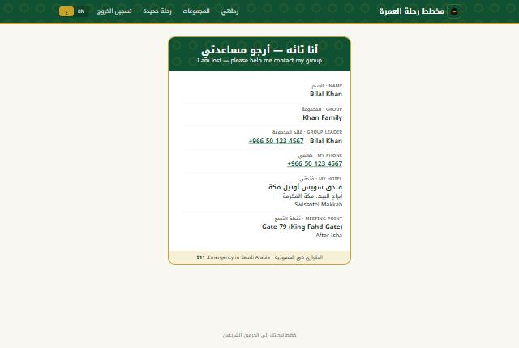 |

| Trip overview | Prayer times & best time for Tawaf |
| --- | --- |
| 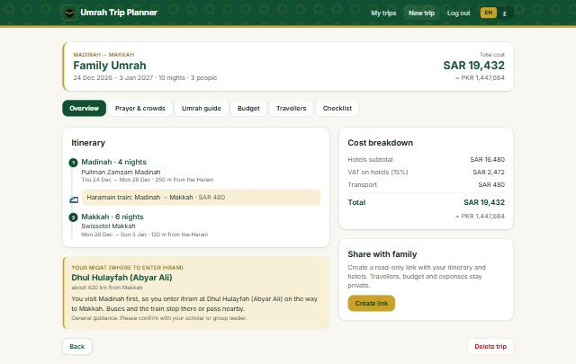 | 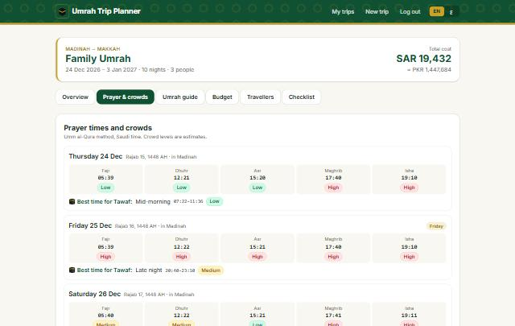 |

| Umrah guide (Arabic, RTL) | Budget & expenses |
| --- | --- |
| 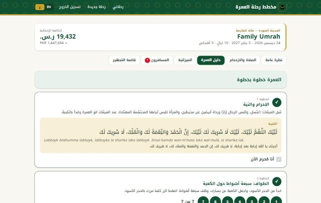 | 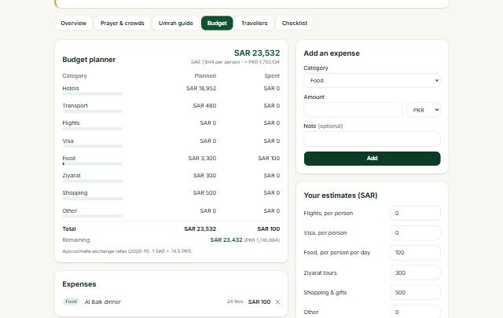 |

| Travellers & document checks | Wizard: intercity transport | Shared plan (Arabic) |
| --- | --- | --- |
| 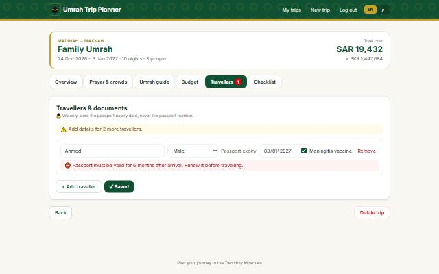 | 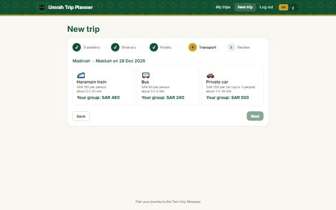 | 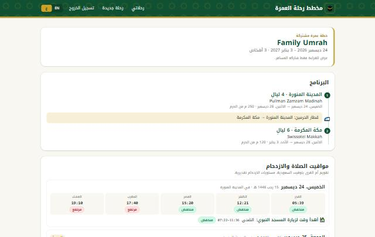 |

## Problems it solves

| Pilgrim problem | Feature |
| --- | --- |
| "How much will the whole trip cost, Madinah and Makkah together?" | Multi-city itinerary (up to 6 stays) with hotel per stay, Haramain train / bus / private car between cities, 15% VAT on hotels, total in SAR **and** your home currency |
| "When is the Haram least crowded?" | Prayer times for every day (Umm al-Qura method) with a crowd badge per prayer and the **best window for Tawaf** (Fridays, Ramadan and summer heat taken into account) |
| "Where do I put on ihram?" | **Miqat guidance** from your origin region and route (e.g. Pakistan → Yalamlam; Madinah first → Dhul Hulayfah), including the train caveat |
| "I lost count of my rounds!" | **Umrah companion**: ihram → Tawaf (7) → Sa'i (7, Safa↔Marwah direction shown) → Halq/Taqsir, with big tap counters, the Talbiyah, and rites enforced in order. Counts completed Umrahs |
| "Will my passport be accepted?" | **Document checks**: passport must be valid 6 months after arrival, meningitis vaccine required, missing travellers flagged. Only the expiry date is stored, never the passport number |
| "Are we over budget?" | **Budget planner** (flights, visa, food per person per day, ziyarat, shopping) + **expense tracker** with spent-vs-planned per category; enter expenses in SAR or your currency |
| "My family wants to know where we are staying." | **Share link**: read-only itinerary + prayer times, no private data, can be revoked |
| "What do I still need to prepare?" | Default 12-item preparation checklist |
| "My elderly father got separated from us in the crowd." | **Group mode**: a leader creates a group, everyone joins with a 6-letter code or QR. Each member gets a **printable lost card** in Arabic + English (name, group, leader's phone, today's hotel with its Arabic name and address, next meeting point, Saudi emergency number, QR code) to show Haram security or a taxi driver |
| "Where do we meet after Isha?" | **Meeting points** set by the leader (place, time, note), shown to everyone and on the lost card |
| "Where is everyone right now?" | **Opt-in live location** for 15–120 minutes: members see each other's last position, distance and a map link; it switches off by itself |

## Features (technical)

- **Auth**: register / login with bcrypt-hashed passwords and JWT (7 days). Token in `localStorage`, attached by an Axios interceptor; a 401 logs the user out.
- **Pricing on the server only**: `POST /api/trips/quote` and `POST /api/trips` use the same `calculateItineraryCost()`, so the review screen shows exactly what is saved.
  - hotels: `nights × price × ceil(people / 2) rooms` per stay, then **+15% VAT**
  - transport (VAT included): train SAR 160 / person, bus SAR 80 / person, private car SAR 550 / car of 4
- **Itinerary validation**: 1–6 stays, each ≥ 1 night, in date order without overlap, ≤ 90 nights (Umrah visa), hotel must be in the stay's city, a transport mode for every city change, warning if there is no Makkah stay.
- **Prayer times** computed astronomically (no external API): Fajr at 18.5°, Asr standard, Isha = Maghrib + 90 min (120 in Ramadan), Saudi time. Verified against published Makkah timetables in tests.
- **Crowd + best time** rules: Fridays, Ramadan and Maghrib/Isha are High; Fajr/Dhuhr on Saturday Medium; mid-morning usually quietest; summer afternoons flagged for heat. Ramadan detection uses the Umm al-Qura Hijri calendar from `Intl`.
- **Ritual state machine** on the server: Sa'i can't start before 7 Tawaf rounds, Halq not before 7 Sa'i rounds, "complete" only when all steps are done. The client saves optimistically and queues requests so fast taps arrive in order.
- **Currency conversion**: SAR → USD (official 3.75 peg), PKR, INR, BDT, IDR, MYR, GBP, EUR, TRY, EGP, AED (approximate reference rates).
- **Legacy data migration**: trips created by the first version (single city/hotel) are upgraded to the multi-stay format the first time they are read.
- **Bilingual UI** with react-i18next (incl. Arabic plural forms), `dir="rtl"` and Tailwind logical properties; Hijri dates shown next to Gregorian.
- **Group mode**:
  - 6-character join codes from an unambiguous alphabet (no 0/O, 1/I/L), unique per group; the leader can issue a new code, which invalidates the old one.
  - Roles: the leader manages meeting points, the linked trip and members; members can edit their own details or leave.
  - The group's hotel for *today* comes from the leader's itinerary (`currentStay`), so the lost card is always up to date.
  - Each member has a random 32-hex `cardToken`; the QR opens a public card that never includes locations or the join code.
  - Live location: only fixed durations (15/30/60/120 min), server-side expiry, positions older than 5 minutes flagged as stale, positions sent at most every 30 s while the page is open, the group page refreshes every 20 s.
  - Hotel Arabic names/addresses fall back to the seed data, so older databases need no migration.
- **Clean architecture**: thin Express controllers that `throw httpError(...)`; business rules in pure services (`tripService`, `groupService`, `ritualService`, `costService`…) that are unit-tested without a database. Client pages use a `useFetch` hook and shared UI (`Alert`, `Section`, `Field`, `OptionButton`, `Tabs`); the wizard is one component per step; heavy pages are code-split with `React.lazy`.

## Tech stack

| Layer | Tools |
| --- | --- |
| Frontend | React 19, Vite, Tailwind CSS v4, React Router, Axios, i18next / react-i18next |
| Backend | Node.js, Express 5, Mongoose, JSON Web Tokens, bcryptjs, dotenv, cors |
| Database | MongoDB Atlas |
| Testing | Jest + Supertest (unit / HTTP), Node test runner + mongodb-memory-server (integration) |
| Hosting | Vercel (client and serverless API), auto-deploy on push |

## Project structure

```
umrah-trip-planner/
├── client/
│   ├── src/api/client.js          Axios instance + interceptors
│   ├── src/components/ui/         Alert, Loading, Section, Field, OptionButton
│   ├── src/components/            Layout, Tabs, AuthForm, CrowdBadge, LanguageSwitcher, MiqatCard, ProtectedRoute
│   ├── src/components/wizard/     one component per wizard step
│   ├── src/components/trip/       OverviewTab, PrayerTab, GuideTab, BudgetTab, TravellersTab, ChecklistTab
│   ├── src/components/group/      MembersTab, MeetingTab, SettingsTab, LostCardView, QrCode
│   ├── src/context/AuthContext.jsx
│   ├── src/hooks/                 useFetch, useMeta, useLocationSharing
│   ├── src/i18n/                  en.json, ar.json
│   ├── src/pages/                 Login, Register, Dashboard, NewTrip, TripDetail, SharedTrip,
│   │                              Groups, GroupDetail, JoinGroup, LostCard
│   ├── src/utils/                 format, itinerary, geo
│   └── vercel.json
├── server/
│   ├── api/index.js               Vercel serverless entry
│   ├── src/app.js                 Express app + central error handler
│   ├── src/controllers/           auth, trip, group (thin: validate → service → respond)
│   ├── src/models/                User, Hotel, Trip, Group
│   ├── src/routes/                auth, hotels, trips, groups, planning
│   ├── src/services/              trip, group, ritual, hotel, cost, crowd, prayerTimes, bestTimes,
│   │                              miqat, budget, currency, document, checklist
│   ├── src/utils/http.js          httpError, validate, assertId, cleanString
│   ├── src/seed.js                8 hotels (upsert, safe to re-run)
│   └── tests/                     Jest unit tests + integration/ (node:test, in-memory MongoDB)
└── docs/screenshots/
```

## Getting started

```bash
git clone https://github.com/abeelmazhar/Umrah-Trip-Planner.git
cd Umrah-Trip-Planner
npm run install:all
cp server/.env.example server/.env   # fill MONGO_URI and JWT_SECRET
npm run seed                         # 8 hotels
npm run dev:server                   # http://localhost:5000
npm run dev:client                   # http://localhost:5173
npm test                             # 86 unit + 21 integration tests
```

| Variable | Where | Description |
| --- | --- | --- |
| `MONGO_URI` | server | MongoDB Atlas connection string (secret) |
| `JWT_SECRET` | server | Long random string used to sign tokens (secret) |
| `JWT_EXPIRES_IN` | server | Token lifetime, e.g. `7d` |
| `CLIENT_ORIGIN` | server | Allowed CORS origin(s), comma-separated |
| `PORT` | server (local) | API port, default `5000` |
| `VITE_API_URL` | client (production) | API base URL; empty locally (Vite proxies `/api`) |

## API

All responses are JSON. 🔒 = requires `Authorization: Bearer <token>`.

| Method | Endpoint | Auth | Description |
| --- | --- | --- | --- |
| GET | `/api/health` | | Health check |
| POST | `/api/auth/register` | | `{ name, email, password, preferredLanguage? }` → `{ token, user }` |
| POST | `/api/auth/login` | | `{ email, password }` → `{ token, user }` |
| GET / PATCH | `/api/auth/me` | 🔒 | Current user / save `preferredLanguage` |
| GET | `/api/hotels?city=Makkah` | | Hotels, nearest to the Haram first |
| POST | `/api/trips/quote` | 🔒 | Price an itinerary without saving (stays, transfers, VAT, miqat, home-currency total) |
| POST | `/api/trips` | 🔒 | `{ title?, people, originRegion, homeCurrency, stays: [{ city, hotelId, checkIn, checkOut }], transferModes: [] }` |
| GET | `/api/trips` | 🔒 | My trips, each with `insights` (route, miqat, budget, spending, document checks, currency) |
| GET / DELETE | `/api/trips/:id` | 🔒 | One trip / delete it |
| PATCH | `/api/trips/:id` | 🔒 | Update `title`, `originRegion`, `homeCurrency`, `travellers[]`, `budget{}` |
| PATCH | `/api/trips/:id/checklist/:itemId` | 🔒 | `{ done }` |
| POST | `/api/trips/:id/expenses` | 🔒 | `{ category, amountSAR, note? }` |
| DELETE | `/api/trips/:id/expenses/:expenseId` | 🔒 | Remove an expense |
| PATCH | `/api/trips/:id/ritual` | 🔒 | `{ ihram?, tawafRounds?, saiRounds?, halq? }` or `{ action: "complete" \| "reset" }` |
| POST / DELETE | `/api/trips/:id/share` | 🔒 | Create / revoke a read-only share link |
| GET | `/api/share/:token` | | Shared itinerary (no travellers, budget or expenses) |
| POST | `/api/groups` | 🔒 | Create a group `{ name, leaderPhone?, tripId? }` (you become leader) |
| GET | `/api/groups` | 🔒 | My groups (role, member count, who is sharing, next meeting point) |
| POST | `/api/groups/join` | 🔒 | `{ code, phone? }` join by code |
| GET | `/api/groups/:id` | 🔒 | Group: today's hotel, members with live locations, meeting points, my lost card |
| PATCH / DELETE | `/api/groups/:id` | 🔒 leader | Rename, leader phone, linked trip / delete group |
| POST | `/api/groups/:id/code` | 🔒 leader | New join code (old one stops working) |
| PATCH | `/api/groups/:id/me` | 🔒 | My name and phone |
| DELETE | `/api/groups/:id/members/:memberId` | 🔒 | Leader removes a member, or a member leaves |
| POST / DELETE | `/api/groups/:id/meeting-points[/:pointId]` | 🔒 leader | Add / remove a meeting point |
| PUT | `/api/groups/:id/location` | 🔒 | `{ lat, lng, accuracy?, minutes? }` start (with minutes) or update sharing |
| DELETE | `/api/groups/:id/location` | 🔒 | Stop sharing and forget the position |
| GET | `/api/lost/:token` | | Public lost card behind the QR code (no location, no join code) |
| GET | `/api/prayer-times?city=&date=&days=` | | Prayer times (up to 31 days) |
| GET | `/api/best-times?city=&date=&days=` | | Prayer times + crowd per prayer + quiet windows + heat warning |
| GET | `/api/crowd?date=&prayer=` | | Crowd level for a date (and prayer) |
| GET | `/api/miqat?origin=&firstCity=` | | Miqat for an origin region and first city |
| GET | `/api/meta` | | Transport prices, origin regions, currencies, expense categories |

## Deployment

Two Vercel projects from this one repository (free, no card). Every push to `main` redeploys both.

1. **MongoDB Atlas**: free cluster, database user, Network Access `0.0.0.0/0` (Vercel has no fixed IPs), seed the hotels.
2. **API**: Vercel project with Root Directory `server`, preset **Other** (so `api/index.js` with the cached DB connection is used). Env: `MONGO_URI`, `JWT_SECRET`, `JWT_EXPIRES_IN`, `CLIENT_ORIGIN`.
3. **Client**: Vercel project with Root Directory `client` (Vite). Env: `VITE_API_URL`. `client/vercel.json` rewrites deep links to `index.html`.
4. Put the client URL in the API's `CLIENT_ORIGIN` and redeploy.

`render.yaml` is kept as an optional alternative (Render asks for card verification).

## Notes

- Hotel prices, transport fares and exchange rates are illustrative reference values (update them in `server/src/data/hotels.js`, `costService.js` and `currencyService.js`).
- Crowd levels and best times are rule-based estimates, not live data. Miqat and ritual guidance is general; pilgrims should confirm with a scholar or group leader.
- `bcryptjs` is used instead of native `bcrypt` so installs work everywhere without build tools.
